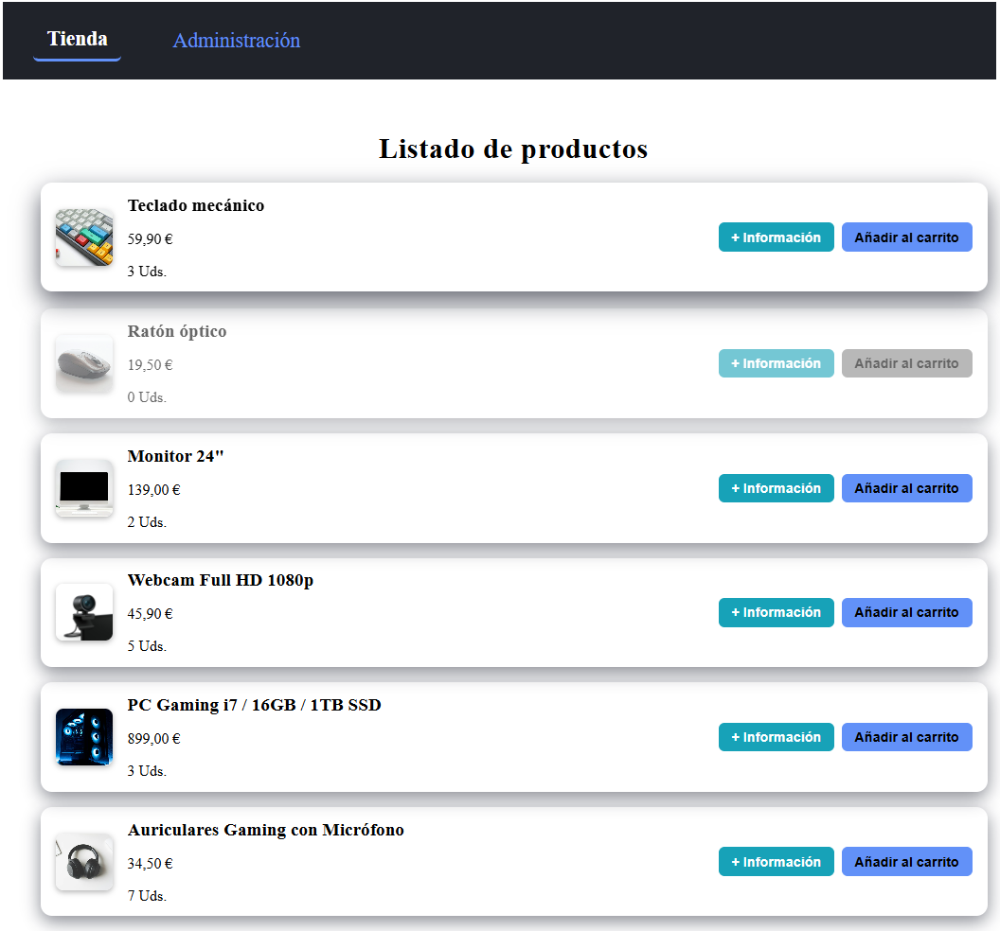
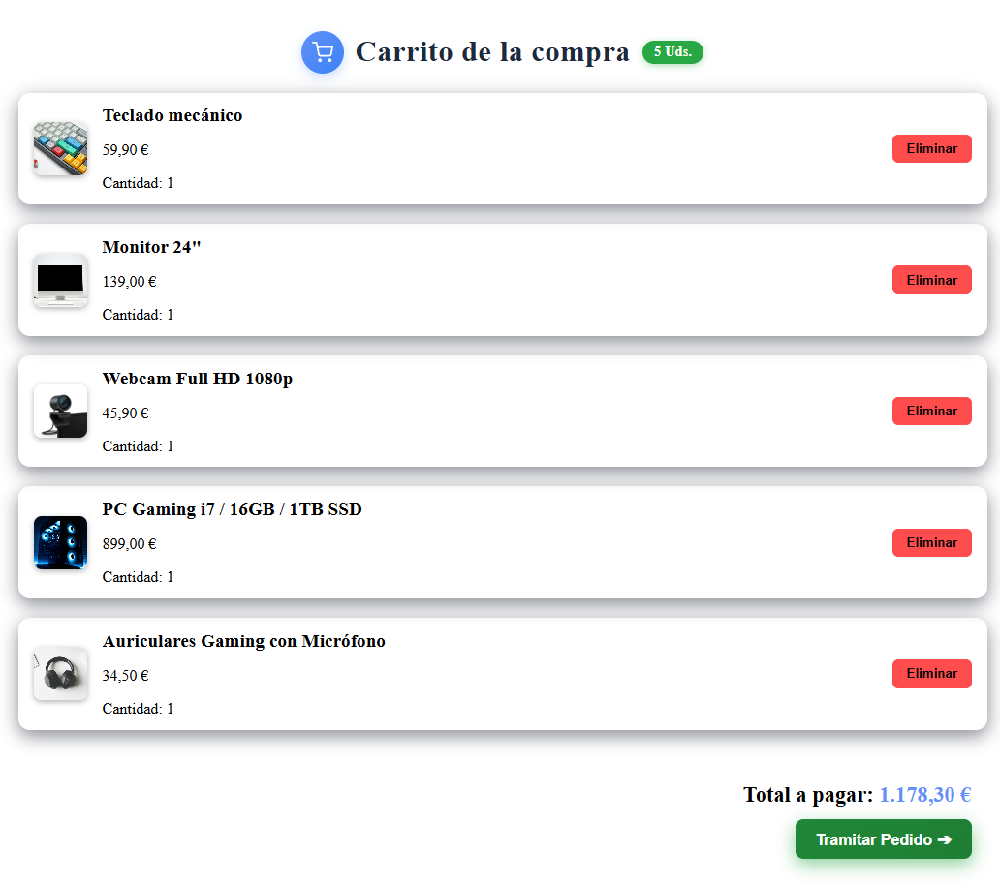
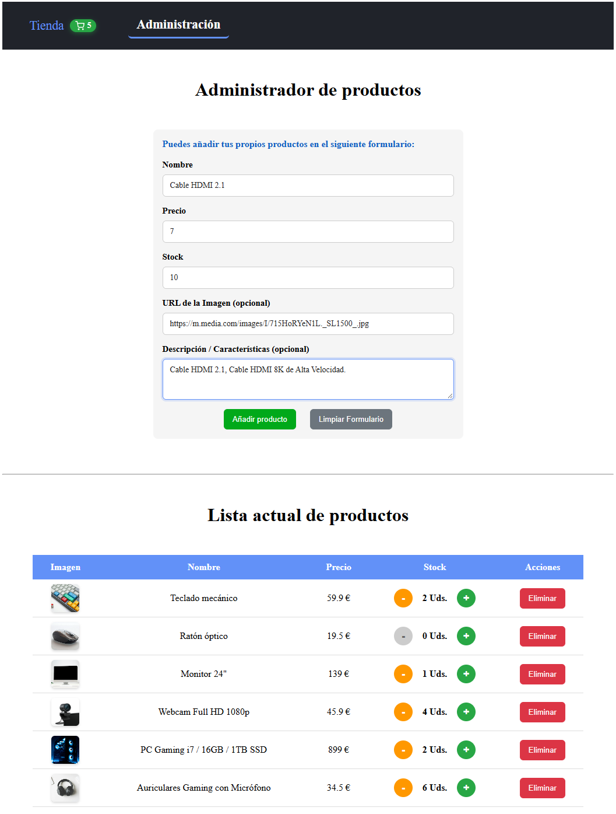

# ByteMarket

ByteMarket es una aplicación de comercio electrónico desarrollada en Angular. El proyecto simula una tienda virtual con gestión de carrito y administración de productos.

## Características Principales

El proyecto se divide en los siguientes módulos principales:

- **Listado de Productos**: Catálogo donde se pueden explorar los artículos disponibles.
- **Carrito de Compra**: Sistema para añadir productos, visualizar el total y gestionar el pedido.
- **Administración de Productos**: Panel de control destinado a la gestión del inventario de la tienda.

## Capturas de Pantalla

A continuación se muestran las secciones más destacadas de la aplicación:

### Vista Principal y Listado de Productos


### Carrito de Compra


### Panel de Administración


## Tecnologías Utilizadas

- **Framework**: [Angular](https://angular.dev/) (Versión 20+)
- **Lenguaje**: TypeScript
- **Estilos**: SCSS (Sass)
- **Estructura**: HTML5

## Instalación y Ejecución Local

Para ejecutar este proyecto en local, sigue estos pasos:

1. Clonar el repositorio:
   ```bash
   git clone https://github.com/chicano76/ByteMarket.git
   cd appCurso
   ```

2. Instalar dependencias:
   ```bash
   npm install
   ```

3. Arrancar el servidor de desarrollo:
   ```bash
   npm start
   ```

4. Ver la aplicación:
   Abre el navegador en `http://localhost:4200/`. La aplicación se recargará automáticamente al realizar cambios en el código fuente.
